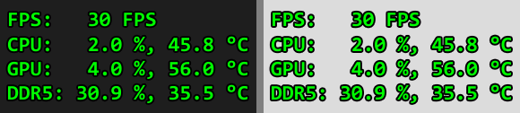
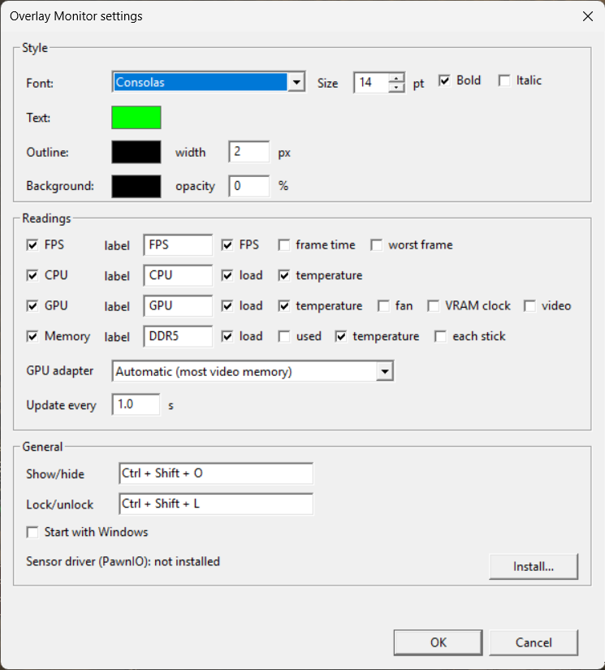
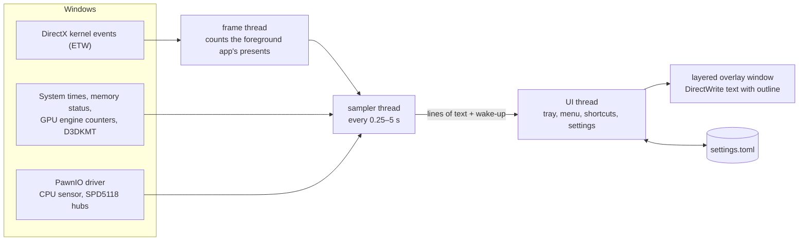
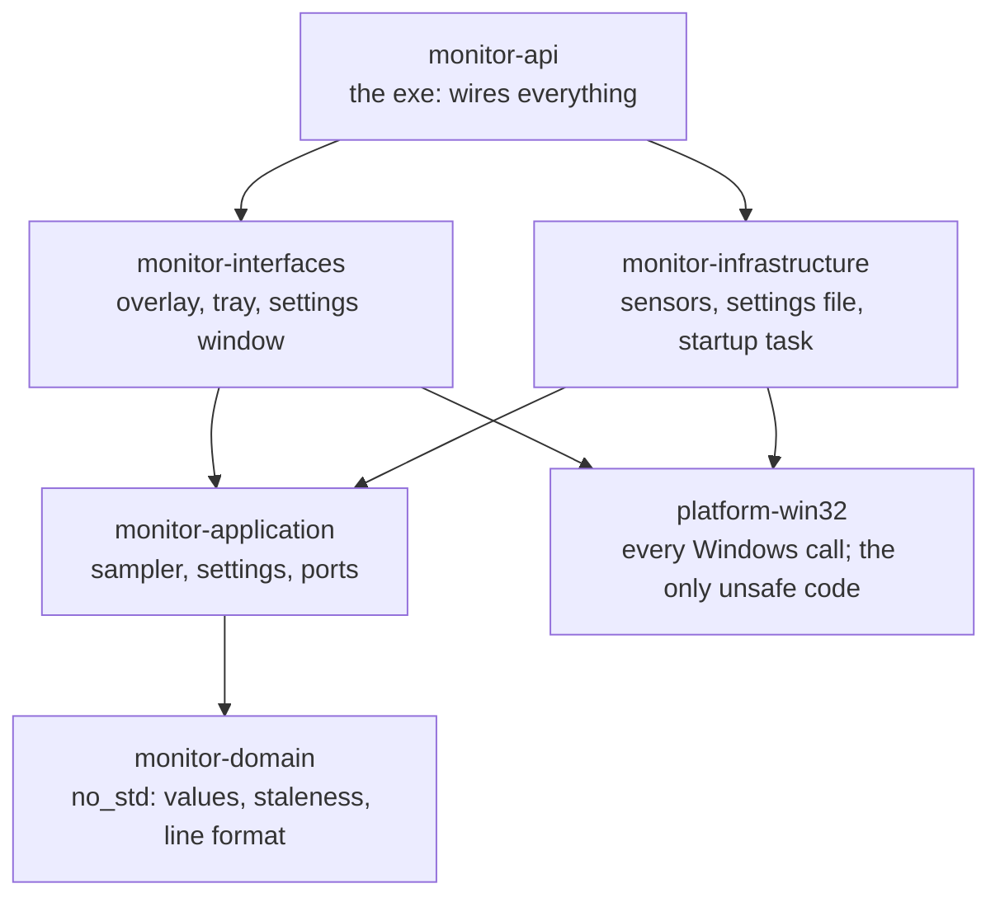

# Overlay Monitor

A small always-on-top readout of FPS, CPU, GPU, and memory load and temperature, over your desktop and borderless games. One Windows app instead of HWiNFO + RTSS + RTSS DesktopOverlayHost.



## Download and run

1. **Optional, for CPU and memory temperatures:** install the [PawnIO](https://pawnio.eu) driver, version 2.1.0 or later.
2. Download `overlay-monitor-<version>-windows-x64.zip` from [Releases](https://github.com/tienduc120/overlay-monitor/releases/latest) and unzip it anywhere. Keep the `modules` folder next to the exe.
3. Run `overlay-monitor.exe` and accept the administrator prompt (FPS and the PawnIO sensors need it). The exe is not code-signed yet: if Windows says "Windows protected your PC", choose **More info → Run anyway**.
4. The overlay appears at the top-left. Drag it anywhere (it snaps to monitor edges and remembers its place). Right-click it, or the tray icon, for **Settings…**, **Lock position**, **Copy diagnostics**, and **Exit**.
5. **Settings → Start with Windows** starts it at sign-in with no administrator prompt.

| Shortcut | Does |
| --- | --- |
| Ctrl+Shift+O | show or hide the overlay |
| Ctrl+Shift+L | lock (clicks pass through) or unlock |

**Uninstall:** untick Start with Windows, choose Exit, then delete the folder, `%APPDATA%\OverlayMonitor` (settings), and `%LOCALAPPDATA%\OverlayMonitor` (log).

Works over the desktop and borderless or windowed games, on Windows 10 1809 or later (x64). It does not draw over exclusive-fullscreen games, because it never injects anything into a game (nothing for anti-cheat to see).

## What it shows

| Line | On by default | Optional (tick in Settings) |
| --- | --- | --- |
| FPS | frames per second of the app in front | frame time, worst frame |
| CPU | load, temperature | |
| GPU | load, temperature | fan speed, VRAM clock, video engine load |
| Memory (`DDR5`, or `RAM` otherwise) | load, temperature of the hottest stick | GB used, each stick's temperature |

A value the PC cannot give shows `—`, never a guess, and so does a value that stops updating. CPU and memory temperatures need PawnIO and administrator; FPS needs administrator (or the "Performance Log Users" group); everything else needs neither. Intel CPUs, Intel-board DDR5, DDR4, and Windows 10 are implemented but not yet tested on real hardware.



Settings live in `%APPDATA%\OverlayMonitor\settings.toml` and a log in `%LOCALAPPDATA%\OverlayMonitor\logs`. When a number looks wrong, choose **Copy diagnostics** and paste the report into an issue.

## How it works



- **No injection.** The overlay is its own see-through, topmost window that never takes focus (`UpdateLayeredWindow` with per-pixel alpha). Text is laid out with DirectWrite, its coverage is grown into the outline, and the app composes the pixels itself, so no Direct2D or Direct3D is loaded. In a FreeSync test the overlay made no measurable difference to how a game presents ([ADR-0016](docs/adr/0016-overlay-presentation.md)).
- **FPS** counts the foreground app's frames from the DirectX kernel's `Present` events, the way PresentMon does; Xbox-app games are followed to the process that actually presents.
- **Loads** come from `GetSystemTimes`, `GlobalMemoryStatusEx`, and the GPU engine counters Task Manager uses. **GPU temperature, fan, and VRAM clock** come from the driver's adapter performance data (D3DKMT).
- **CPU and DDR5 temperatures** go through the signed [PawnIO](https://github.com/namazso/PawnIO) driver: AMD's SMN register or Intel's thermal MSRs, and the SPD5118 sensor hubs on the memory's SMBus. Hardware is only ever read, under the same shared locks HWiNFO and LibreHardwareMonitor take.
- **Light:** three threads started with `std::thread::scope`, no async runtime; about 9 MB of private memory and a 2.5 MB exe ([ADR-0022](docs/adr/0022-a-lean-runtime.md)).



The code is Rust in clean-architecture layers, one crate per layer, on a copy of a strict template: lint, layer, and source rules are checked by `cargo xtask verify`, and each rule has a fixture that proves it fires. Decisions are in [docs/adr/](docs/adr/README.md), work left on purpose in [docs/deferred.md](docs/deferred.md).

## Build from source

You need rustup (it reads `rust-toolchain.toml`), Git, and the Visual Studio Build Tools with the C++ workload.

```powershell
cargo xtask modules                                       # download and hash-check the PawnIO modules into target\*\modules
cargo build -p monitor-api --release --features elevated  # target\release\overlay-monitor.exe, asks for administrator
cargo nextest run -p <crate>                              # tests (admin and hardware tests are #[ignore])
cargo xtask verify                                        # every gate; --full adds supply chain, docs, and the rules proof
```

Without `--features elevated` the exe runs as the current user, and the CPU and memory temperatures show `—`. Read [AGENTS.md](AGENTS.md) before changing code.

## License and credits

MIT, Copyright (c) 2026 Luu Tien Duc. See [LICENSE](LICENSE). The release zip also carries PawnIO's modules under LGPL-2.1 ([NOTICE.md](NOTICE.md)).

<details>
<summary>Credits</summary>

Material that is copied or adapted is listed in [NOTICE.md](NOTICE.md) with its license; this section thanks everyone whose work shaped a decision, whether or not any text was copied.

**Used**

- The Rust project: the language, cargo, rustfmt, clippy, and rustdoc.
- Crates: [serde](https://github.com/serde-rs/serde), [toml and toml_edit](https://github.com/toml-rs/toml) (`serde` and `toml` read and write the settings file), [thiserror](https://github.com/dtolnay/thiserror), [anyhow](https://github.com/dtolnay/anyhow), [tracing](https://github.com/tokio-rs/tracing), [jiff](https://github.com/BurntSushi/jiff), [clap](https://github.com/clap-rs/clap), [syn](https://github.com/dtolnay/syn), [cargo_metadata](https://github.com/oli-obk/cargo_metadata), [walkdir](https://github.com/BurntSushi/walkdir), [serde_json](https://github.com/serde-rs/json), [embed-resource](https://github.com/nabijaczleweli/rust-embed-resource) (the exe icon and version), the [`windows`](https://github.com/microsoft/windows-rs) crate.
- [PawnIO](https://github.com/namazso/PawnIO) and [PawnIO.Modules](https://github.com/namazso/PawnIO.Modules): the driver the app talks to, and the LGPL-2.1 modules shipped beside the exe, never committed.
- The app icon (`services/monitor/api/assets/icon.ico`) is the owner's own work, made with Claude; it has no third-party source or license.
- Developer tools: [cargo-nextest](https://github.com/nextest-rs/nextest), [cargo-deny](https://github.com/EmbarkStudios/cargo-deny), [cargo-shear](https://github.com/Boshen/cargo-shear), [typos](https://github.com/crate-ci/typos), [lefthook](https://github.com/evilmartians/lefthook), [cargo-binstall](https://github.com/cargo-bins/cargo-binstall), [zizmor](https://github.com/zizmorcore/zizmor), [taiki-e/install-action](https://github.com/taiki-e/install-action), [Swatinem/rust-cache](https://github.com/Swatinem/rust-cache).

**Referenced for design** (no code copied)

| Source | What shaped us |
| --- | --- |
| [go-base](https://github.com/tienduc120/go-base) | every rule proven by a fixture, one command surface, the agent guard, the layer rules |
| [matklad's cargo xtask](https://github.com/matklad/cargo-xtask) | tooling in Rust, run with `cargo xtask` instead of Make |
| [zed](https://github.com/zed-industries/zed) | forbidden crate edges checked from the dependency graph; no `mod.rs` files |
| [openai/codex](https://github.com/openai/codex) | `unwrap_used`/`expect_used` at deny with test exemptions; cargo-deny `wrappers`; the clean-worktree check in CI |
| [astral-sh/uv](https://github.com/astral-sh/uv) and [ruff](https://github.com/astral-sh/ruff) | `CARGO_BUILD_WARNINGS=deny`; nextest timeouts; agent rules on panics, `#[expect]`, and exhaustive matches |
| [rust-analyzer](https://github.com/rust-lang/rust-analyzer) | tidy checks as tests in xtask; new dependencies and public items as architectural changes |
| [Microsoft Pragmatic Rust Guidelines](https://microsoft.github.io/rust-guidelines/) | lint posture, `#[expect]` over `#[allow]`, errors per layer |
| [How To Code It: hexagonal architecture in Rust](https://www.howtocodeit.com/articles/master-hexagonal-architecture-rust) | ports as traits, generics over `dyn` |
| [AGENTS.md](https://agents.md) | the shared agent instruction format |
| [PresentMon](https://github.com/GameTechDev/PresentMon) (MIT) | counting presented frames from ETW |
| [spd5118 documentation](https://docs.kernel.org/hwmon/spd5118.html) (Linux kernel) | the SPD5118 temperature register format |
| [Linux `k10temp` driver](https://docs.kernel.org/hwmon/k10temp.html) (GPL-2.0) | the Tctl offsets for Zen 1 and Zen+ parts: the values only, no code |
| Intel 64 and IA-32 Architectures Software Developer's Manual, Volume 4 | the layout of MSRs 0x1B1 and 0x1A2 |
| DMTF SMBIOS Reference Specification (DSP0134), type 17 | reading the installed memory's type from the firmware table |

</details>
